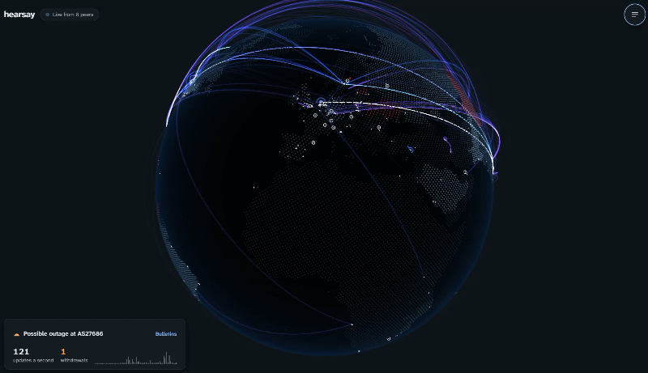

<h1 align="center">hearsay</h1>
<p align="center">
<i>The internet's routing, live on a globe</i>
<br />
<b>🌐 <a href="https://hearsay.peng.ly/">hearsay.peng.ly</a></b><br />
</p>

<p align="center">

</p>

<details>
  <summary>Contents</summary>

- [About](#about)
- [Usage](#usage)
- [Deployment](#deployment)
- [Configuration](#configuration)
- [Development](#development)
- [Credits](#credits)

</details>

## About

The internet is about 80,000 separate networks (autonomous systems), each telling its neighbours which addresses it can reach. That's BGP, and since nobody checks most of what gets passed along, it pretty much runs on hearsay.

This app draws each event as it happens, plotting it on a 3d globe. A small relay listens to every router feeding RIPE's [RIS Live](https://ris-live.ripe.net/) (around 800 of them, sending 7,000 or so updates a second) and passes your browser a few KB a second of it: a fair sample of routes, linked across the globe hop by hop from the network that owns each one to the router that told us about it, plus a count of everything else. Announcements are blue, path changes violet, withdrawals amber.

While it listens, it watches for anything odd: possible route leaks (a small network sat between two giants), prefixes changing hands, networks pulling lots of routes at once, bursts of withdrawals, flapping, bogons and silly amounts of prepending. Confirmed outages, leaks and hijacks from [Cloudflare Radar](https://radar.cloudflare.com/) and [IODA](https://ioda.inetintel.cc.gatech.edu/) sit alongside them, and there's a routing forecast per region, in the style of the shipping forecast.

---

## Usage

Drag to turn the globe, pinch or scroll to zoom, or use the arrow keys and `+` / `-`. Tap any network to see what it's been up to, who it reaches the world through, and to watch it. Everything else (bulletins, the forecast, settings and the key) lives in the menu.

Networks sit in the country they're registered in, near one of its bigger cities. That's a rough guess, not where their routers really are, and the About panel says so too.

It's light on data by default: about 10 KB a second on a phone, more on a big screen, and it stops listening when you switch tabs. A selected network is a link you can share, like [`hearsay.peng.ly/?as=13335`](https://hearsay.peng.ly/?as=13335).

---

## Deployment

### Option 1: Cloudflare Workers

Fork the repo, change (or delete) `routes` in `wrangler.jsonc`, then either trigger the deploy workflow, or run:

```bash
npm install
ADAPTER=cloudflare npm run build
npx wrangler deploy
npx wrangler deploy -c src/relay/wrangler.jsonc
```

The second deploy is the relay, a Durable Object that needs the Workers Paid plan. Change its route in `src/relay/wrangler.jsonc` to match your domain. It only listens while someone has the page open and stops for the month after about $20 of Cloudflare usage. Without it, the app just listens to a few RIS peers directly.

### Option 2: Docker

There's a multi-arch image on DockerHub ([`notaflightrisk/hearsay`](https://hub.docker.com/r/notaflightrisk/hearsay)) and GHCR ([`ghcr.io/notaflightrisk/hearsay`](https://github.com/NotAFlightRisk/hearsay/pkgs/container/hearsay))

```shell
docker run -p 3000:3000 notaflightrisk/hearsay
```

The relay only runs on Workers, so the image listens to a few RIS peers directly.

### Option 3: From a release

Grab `site.zip` from the [latest release](https://github.com/NotAFlightRisk/hearsay/releases/latest), unzip it and run `node build`, and pop open localhost:3000

### Option 4: Build from source

Follow the [Development](#development) steps, then `npm run build` and `node build`.

---

## Configuration

There's only one setting, and it's optional. `RADAR_TOKEN` is a Cloudflare API token with Radar read access, which adds Radar's confirmed outages, leaks and hijacks to the bulletins. Without it you still get IODA's outages and everything spotted live. Like with Docker, set with `-e RADAR_TOKEN=your-token notaflightrisk/hearsay`, or for Workers use `npx wrangler secret put RADAR_TOKEN`.

---

## Development

You'll need [Node](https://nodejs.org/) 22.18 or newer. It's a [SvelteKit](https://svelte.dev/docs/kit) app with a [three.js](https://threejs.org/) globe, and there's nothing else to set up.

```bash
git clone git@github.com:NotAFlightRisk/hearsay.git
cd hearsay
npm install
npm run dev
```

The dev server is then on [localhost:5173](http://localhost:5173). The other scripts you'll want are `npm run check` (types), `npm test` and `npm run format`. Alternatively, build the container with `docker build -t hearsay .`

The stream, the parsing and the anomaly rules all run in a Web Worker (`src/lib/stream/`, `src/lib/bgp/`), so the main thread only has to draw. The relay's in `src/relay/` and `src/lib/relay/`. To try it locally, run `npx wrangler dev -c src/relay/wrangler.jsonc`, then start the app with `RELAY=ws://localhost:8787 npm run dev`. The network names, countries, map and RIS peers in `static/data/` and `src/lib/data/` are generated, and `npm run data` fetches fresh copies.

---

## Credits

Routes come from RIPE NCC's [Routing Information Service](https://ris.ripe.net/), network names from [RIPE's AS names list](https://ftp.ripe.net/ripe/asnames/) and lookups from [RIPEstat](https://stat.ripe.net/). Confirmed incidents are from [Cloudflare Radar](https://radar.cloudflare.com/) and [IODA](https://ioda.inetintel.cc.gatech.edu/) at Georgia Tech, and the map is [Natural Earth](https://www.naturalearthdata.com/). Thanks to all of them for keeping it open.

##### Contributors

[](https://github.com/NotAFlightRisk/hearsay/graphs/contributors)

---

<!-- License + Copyright -->
<p  align="center">
  <a href="https://github.com/NotAFlightRisk"></a><br>
  <sup>
    <i>Licensed under <a href="../LICENSE">MIT</a>, © <a href="https://peng.ly">NotAFlightRisk</a> 2026</i>
  </sup>
</p>

<!--
oooh, hello there! hope you're having a nice day :)
   |\__      |\___
 (:> __)X  (:o ___(
   |/        |/
-->
